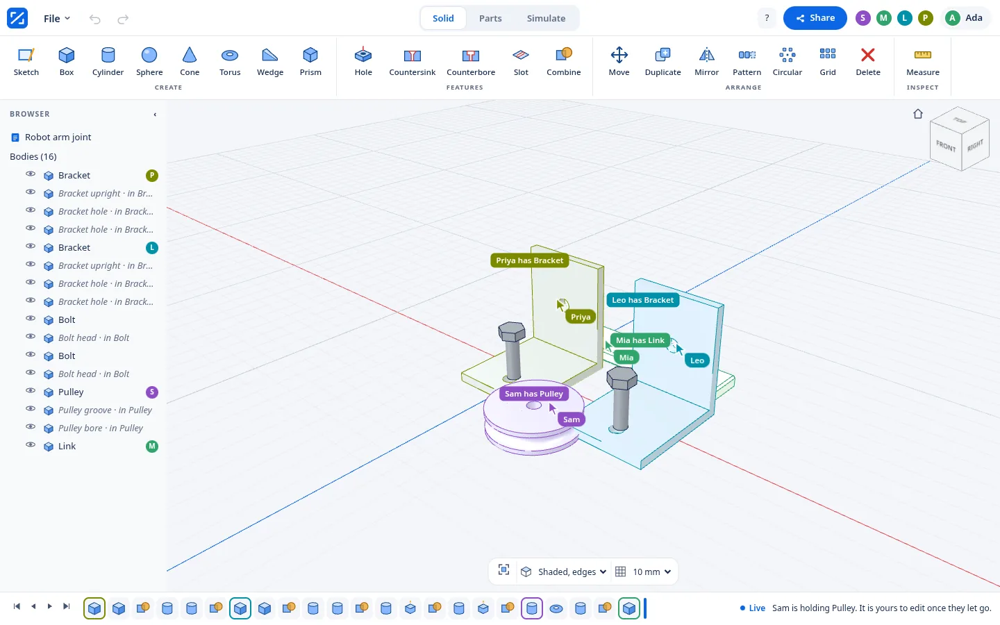
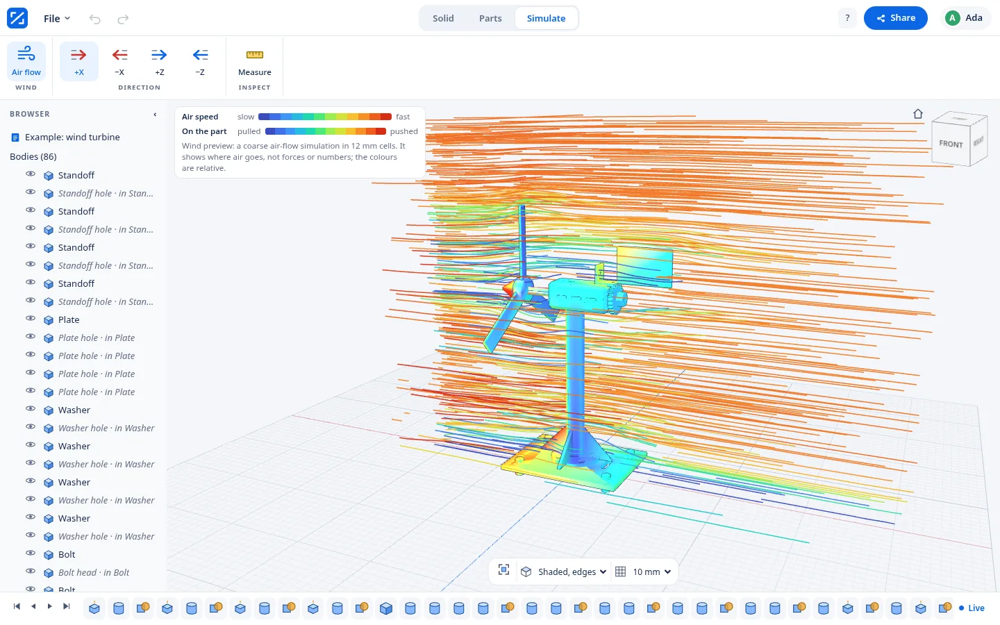
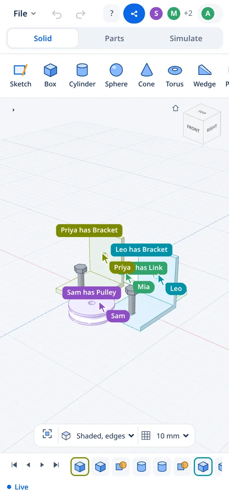

# Bench

A multiplayer CAD app that lets a group of students work
on one 3D part at the same time. Anyone who opens the link to a design joins
everyone else who has it open and can see what they are doing.

## How to use it

1. I type a name on the home page and press **Launch Bench** which makes a new
   design. I test it as two people by opening a second browser or an incognito
   window.
2. I place a box from the **Solid** tab or a bolt from the **Parts** tab and
   select it so I can type its exact sizes.
3. When I press **Share** I get one link that lets a friend edit the design and
   another that only lets them watch.
4. I download the finished part with **Export STL** in the **File** menu, and
   the example wind turbine shows air flowing past it in the **Simulate** tab.

## What good means here

I decided Bench is good when a small group can design a real part together and
trust what comes out, so I wrote four promises.

1. I made sure the numbers in Bench can be trusted, because each size is typed
   in millimetres and the server builds the STL file with the same code the
   browser uses to draw the model.
2. I made sure nobody has their work overwritten without seeing it. Selecting a
   body places a hold on it and the server refuses an edit made against an old
   version with a message naming whoever got there first. Most shared canvases
   let the last write win without telling anyone, which is wrong for a hole
   that a bolt has to go through, as my decision record [ADR
   0001](docs/adr/0001-two-people-one-body.md) explains.
3. I made the other people visible, which is why cursors and names appear in
   the 3D view and bodies move on every screen while someone is dragging them.
4. I made sure what anyone does in a design stays there by writing each change
   to disk before the server tells anyone about it, which is why a design
   survives a restart.

## What it does not do

I chose not to build accounts, chat, comments or branches, and I left out
fillets on picked edges and assemblies because each would take months and a
half working version would break the first promise. I kept project lists and
imported models in the browser, which is why the server holds no profiles and
no uploaded files.

## What is checked and what is judged

I wrote tests in `spec/` that run against the running server and check that a
change by one person appears for another within a second. They also check that
held bodies and stale edits are refused with a written reason and that a view
only link is refused every change.

The rest I judged by using Bench as two people in two browsers with one at
phone size, where I looked at whether the first five minutes felt easy and
whether the model looked right.

## Sources

I took the idea of one server that decides every change from "How Figma's
multiplayer technology works" by Evan Wallace in 2019, although I refused its
rule that the last write wins.

I read "Local first software" by Martin Kleppmann and others in 2019 and
decided not to follow its case for merging offline edits.

The essays "An app can be a home cooked meal" by Robin Sloan in 2020 and
"Situated Software" by Clay Shirky in 2004 gave me confidence to build for a
few students rather than a market.
